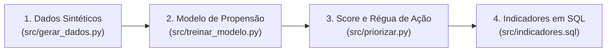
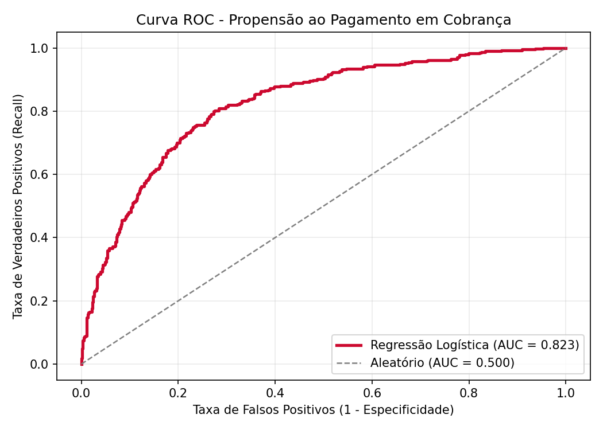
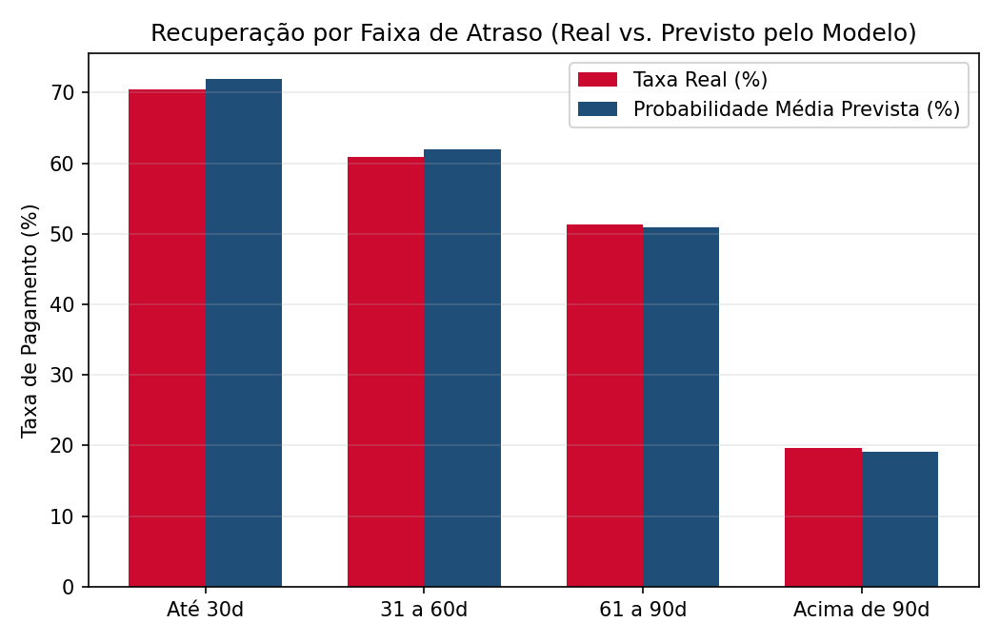

# Priorizador de Cobrança com IA

Pipeline de análise, modelagem preditiva e priorização de contatos para uma operação de cobrança bancária.

---

## Problema

Em uma operação de cobrança, milhares de clientes entram em atraso diariamente, mas a capacidade da equipe de atendimento humano é limitada. Acionar todos os clientes na mesma ordem ou pelo mesmo canal gera alto custo operacional e baixa eficiência.

O objetivo deste projeto é estimar a **probabilidade de pagamento** de cada cliente inadimplente e combiná-la ao **valor da dívida** para responder duas perguntas de negócio:
1. **Quem acionar primeiro?** (ordenando pelo retorno financeiro esperado)
2. **Por qual canal acionar?** (automatizando contatos de baixo risco e concentrando operadores humanos onde o contato ativo faz diferença)

---

## Abordagem



1. **Dados Sintéticos (`src/gerar_dados.py`):** Gera 5.000 clientes fictícios com variáveis de atraso, histórico, renda, relacionamento e canal preferido. A variável alvo (`pagou`) é gerada por uma regra probabilística (função sigmoide com ruído e penalidade não-linear após 90 dias de atraso).
2. **Modelagem (`src/treinar_modelo.py`):** Utiliza `Pipeline` e `ColumnTransformer` (`StandardScaler` nas numéricas + `OneHotEncoder` nas categóricas) para evitar vazamento de dados (*data leakage*). Compara **Regressão Logística** e **Gradient Boosting** em validação cruzada de 5 folds e avalia o ganho de variáveis derivadas de negócio (`divida_relativa` à renda e marco `atraso_90`).
3. **Priorização e Régua de Acionamento (`src/priorizar.py`):**
   - **Score de Prioridade (Valor Esperado):** $\text{Score (R\$)} = P(\text{pagar}) \times \text{Valor Devido}$. Prioriza onde o esforço de cobrança tem maior retorno esperado.
   - **Ação Sugerida (definida pela faixa de propensão):**
     - **Alta ($\ge 60\%$):** `Mensagem Automatica` (cliente com alta chance de autoliquidação; acionamento digital de baixo custo).
     - **Média ($30\%$ a $60\%$):** `Ligacao` (foco da equipe humana de atendimento, ordenada pelo maior valor esperado).
     - **Baixa ($< 30\%$):** `Proposta de Acordo` (oferta automatizada de parcelamento ou desconto).
4. **Indicadores em SQL (`src/indicadores.sql`):** Persiste a carteira priorizada em um banco **SQLite** e extrai indicadores de recuperação por faixa de atraso, exposição por faixa de propensão, conversão por canal e a fila Top 20 para contato humano.

---

## Estrutura do Projeto

```text
priorizador-cobranca/
├── README.md
├── requirements.txt
├── run_pipeline.py
├── assets/
│   ├── curva_roc.png
│   └── recuperacao_por_atraso.png
├── src/
│   ├── gerar_dados.py
│   ├── treinar_modelo.py
│   ├── priorizar.py
│   └── indicadores.sql
└── tests/
    └── test_priorizar.py
```

---

## Como Rodar

Instale as dependências e execute o pipeline completo (ou rode etapa por etapa):

```bash
pip install -r requirements.txt

# Opção 1: Rodar o pipeline completo de ponta a ponta
python run_pipeline.py

# Opção 2: Rodar cada módulo individualmente
python -m src.gerar_dados
python -m src.treinar_modelo
python -m src.priorizar

# Executar os testes automatizados
pytest
```

---

## Resultados

### 1. Desempenho dos Modelos (Validação Cruzada 5-Fold e Conjunto de Teste 20%)

| Abordagem | CV AUC (média ± dp) | Teste AUC |
| :--- | :---: | :---: |
| Regressão Logística (features brutas) | 0.8153 ± 0.0108 | 0.7881 |
| Gradient Boosting (features brutas, padrão) | 0.8094 ± 0.0127 | 0.7794 |
| **Regressão Logística (+ features de negócio)** | **0.8179 ± 0.0125** | **0.7890** |

- **Escolha do modelo:** Regressão Logística e Gradient Boosting tiveram empate técnico na validação cruzada. A **Regressão Logística** foi escolhida por ser mais simples e oferecer interpretabilidade direta via coeficientes (requisito comum em crédito e cobrança). A criação das variáveis de negócio (`divida_relativa` e `atraso_90`) trouxe ganho superior à troca de algoritmo.



### 2. Calibração da Régua de Acionamento (SQL)

| Faixa de Propensão | Ação Sugerida | Clientes | Valor em Aberto (R\$) | Valor Esperado Recuperável (R\$) | Taxa Real de Pagamento (%) |
| :--- | :--- | :---: | :---: | :---: | :---: |
| **Alta** ($\ge 60\%$) | Mensagem Automática | 1.411 | 2.052.922,37 | 1.537.687,67 | **74,5%** |
| **Média** ($30\%$ a $60\%$) | Ligação | 1.331 | 2.309.332,51 | 1.034.195,18 | **44,5%** |
| **Baixa** ($< 30\%$) | Proposta de Acordo | 2.258 | 4.718.569,64 | 590.605,00 | **15,3%** |



---

## Limitações

- **Dados 100% fictícios:** A base foi simulada por regra probabilística definida no código (`src/gerar_dados.py`) com semente fixa (`SEED = 42`, reprodutível com a mesma versão das bibliotecas). O modelo redesenha o sinal inserido na simulação, portanto as métricas não representam desempenho em dados reais.
- **Escopo da base nos indicadores SQL:** As consultas SQL e o gráfico de recuperação por atraso são demonstrados sobre a base histórica completa (5.000 clientes, incluindo a parcela de treino). Em uso real, o modelo seria aplicado apenas a clientes em aberto cujo desfecho (`pagou`) ainda é desconhecido.
- **Parâmetros de corte fixos:** Os limiares de propensão (`0.30` e `0.60`) foram fixados para demonstração; em uma operação real, dependem da capacidade diária da equipe e do custo unitário de cada canal.
- **Sem validação temporal (*out-of-time*):** A divisão treino/teste foi feita por amostragem estratificada simples, sem janela temporal.
- **Sem *tuning* de hiperparâmetros:** O Gradient Boosting foi avaliado com parâmetros padrão do `scikit-learn`.

---

## Próximos Passos

- Implementar validação temporal (*out-of-time*) simulando safras mensais de inadimplência.
- Otimizar os pontos de corte da régua considerando o custo de cada canal (custo de ligação vs. disparo digital).
- Adicionar monitoramento de estabilidade da população (PSI / *data drift*).
